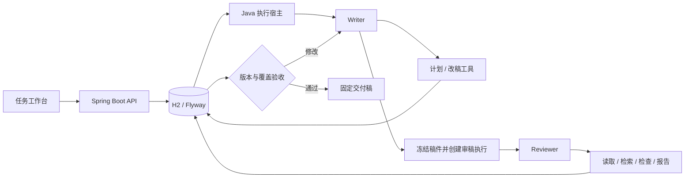

# ScriptForge

**让长篇口播稿的创作、审稿与修订过程可以追溯。**

[在线演示](https://coder1025.github.io/scriptforge/?demo=1) · [GitHub 仓库](https://github.com/coder1025/scriptforge) · [自动化检查](https://github.com/coder1025/scriptforge/actions/workflows/ci.yml) · [English](README.en.md)

ScriptForge 是一套独立实现的 Java 双 Agent 创作系统：Writer 规划和写稿，Reviewer 独立读取原文、检查依据、审阅衔接并提出修订，Java 宿主负责版本、权限、持久化、预算及最终交付。

它面向脚本生成场景，也是一份可以运行、阅读和验证的 Agent 工程样本。全部示例采用虚构商品，不依赖既有商业系统。

[快速运行](#快速运行) · [架构说明](docs/architecture.md) · [工具与接口](docs/api-and-tools.md) · [开源与展示](docs/publishing.md) · [学习与面试](docs/walkthrough.md) · [评测方法](docs/evaluation.md) · [验证记录](docs/verification.md)

## 看什么

- **独立审稿**：Reviewer 拥有自己的执行记录和工具循环；它可读稿、找依据、运行检查，不能直接改稿或批准交付。
- **版本化创作**：计划、稿件与审稿报告绑定版本。模型输出经工具校验后落库，普通聊天回复不等于正式产物。
- **可恢复执行**：工具调用意图、执行结果和工作状态持久化；审稿等待释放工作线程，不让一个 HTTP 请求挂住整个任务。
- **动态上下文**：按角色、当前任务和段落选择资料，保留必要事实与问题；历史工具往返成对保留，超预算时整理并记录检查点。
- **可解释的质量门槛**：段落覆盖、相邻关系、明确依赖和确定性检查由宿主核对；语义审稿提供具体原文、证据和修改目标。
- **可视化过程**：查看 Agent 轨迹、报告、稿件版本、上下文检查点和用量；同一个页面支持本地运行与静态演示。

## 两种演示，一种真实接入

| 入口 | 实际运行什么 | 适合谁 |
| --- | --- | --- |
| GitHub Pages / `?demo=1` | 浏览器回放固定样例，无 Java、无模型调用 | 先了解项目的访客 |
| 本地 `DEMO` | 真实 Java 执行器、数据库和工具，使用确定性模型替身 | 阅读源码、调试状态流、复现测试 |
| 本地或自托管 `MODEL` | 同一执行器接入支持工具调用的真实模型 | 验证创作质量、评测与实际使用 |

演示完成状态是 `DEMO_READY`；它证明示例链路可以跑通，不证明真实模型写作质量。真实模式通过验收后才进入 `READY`，仍应按业务要求复核文案。

## 快速运行

需要 **JDK 21、Maven 3.9+**。前端无 Node.js 构建依赖。

```bash
mvn clean verify
java -jar target/scriptforge-0.1.0.jar
```

打开 [http://localhost:8080](http://localhost:8080)。创建内置的“折叠收纳盒”演示任务，观察：规划 → 写稿 → 审稿发现无依据的承重声明 → 定向修改 → 复审 → 演示完成。

默认数据库保存在 `./data/`，重启后可继续查看任务与版本。请不要提交这个目录。

服务启动后可运行 `python3 scripts/smoke.py` 验证 HTTP 全链路。使用其他端口时传入 `--base-url http://127.0.0.1:端口`。Java 格式检查使用 `mvn spotless:check`，格式修复使用 `mvn spotless:apply`。

也可以使用 Docker：

```bash
cp .env.example .env
docker compose up --build -d
```

Compose 默认只向宿主机的 `127.0.0.1` 发布端口。停止容器使用 `docker compose down`；不要加 `--volumes`，除非确实要删除任务数据。

## 接入真实模型

适配器使用 **OpenAI-compatible Chat Completions 工具调用协议**。所选服务和模型需要支持工具 Schema、`tool_choice=required` 和 `parallel_tool_calls=false`；“兼容 OpenAI”并不自动代表所有模型支持这些能力。

以环境变量启动：

```bash
export SCRIPT_FORGE_MODE=MODEL
export MODEL_BASE_URL=https://api.openai.com/v1
export MODEL_NAME='填写你已开通且支持工具调用的模型名'
read -s MODEL_API_KEY
export MODEL_API_KEY
java -jar target/scriptforge-0.1.0.jar
```

不要把密钥写进源码或网页。使用 Docker 时在本地 `.env` 中配置同名变量，并设置 `ADMIN_TOKEN`；真实模式绑定非回环地址时必须配置访问令牌。完整部署说明见 [配置与发布](docs/publishing.md)。

模型调用会产生供应商费用。任务设置限制调用次数和 token 用量；token 预估与供应商实际计费可能不同，供应商账户的额度控制仍然有用。

## 技术结构



Java 21、Spring Boot 3.5、Spring JDBC、Flyway、H2、Java HttpClient；前端采用原生 HTML/CSS/JavaScript。状态控制显式实现，便于学习事务边界、模型工具协议和恢复行为；目前没有引入复杂 Agent 框架。

```text
src/main/java/dev/scriptforge/
  api/       HTTP 与访问边界
  model/     模型协议与演示替身
  runtime/   调度、角色执行、上下文
  store/     持久化
  tools/     工具定义与执行
src/main/resources/
  prompts/   Writer / Reviewer 系统指令
  static/    工作台与离线演示
  db/        数据库迁移
src/test/    无付费模型依赖的自动化测试
```

## 当前范围

这是 **单工作区、单服务实例** 的开源首版。单任务最多 30 分钟目标时长、24 段计划；时长是文本估计，尚未使用 TTS 实测。它不承诺 24 小时稿件、生产级集群调度、多人权限隔离、全网查重或语义零错误。

确定性检查只能发现定义好的规则问题。低重复、创造性、内容效果和真实模型的审稿收益，需要使用 [评测集与人工盲评](docs/evaluation.md) 验证。双 Agent 增加了独立检查机会，也增加调用成本与产生共同盲点的可能。

当前项目不包含数字人、视频合成或自动开播供应商接入；它交付的是带版本和审稿记录的脚本。后续可通过明确的交付接口扩展。

## 贡献与许可

见 [贡献说明](CONTRIBUTING.md) 和 [安全说明](SECURITY.md)。代码采用 [Apache-2.0](LICENSE)。公开展示请保留演示来源标记，不将固定回放包装成实时模型效果。

