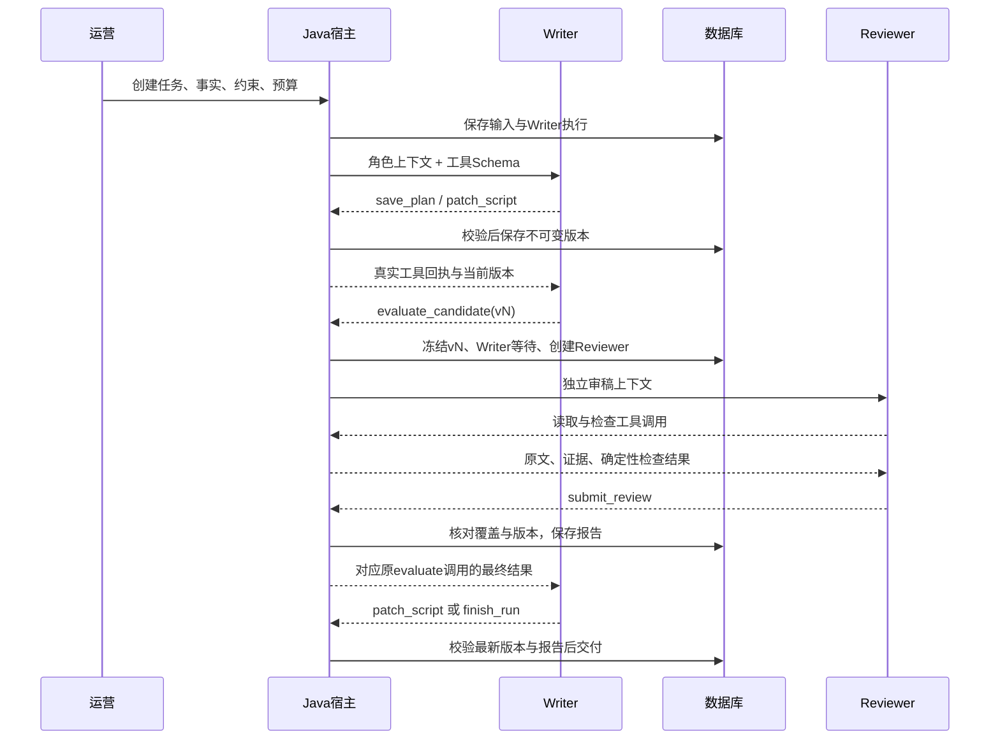
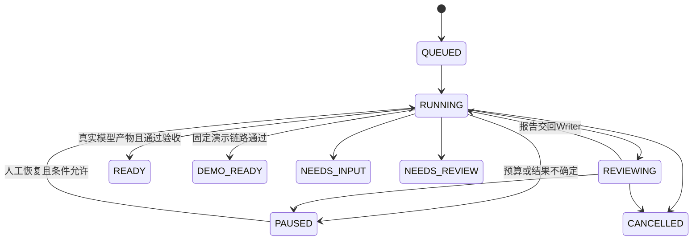

# 执行架构与一致性边界

## 三个执行主体

Writer 决定如何组织内容、调用哪些写作工具以及怎样修订。Reviewer 从被冻结的稿件、事实和审稿规则开始，独立读取原文、检查依据并提交报告。Java 宿主决定哪些操作能够执行、结果能否接受、任务是否可以交付。

两名 Agent 都有“选择工具 → 执行 → 观察结果 → 继续”的循环。角色拆分不会替代这个循环；它让审稿目标、权限、上下文和执行记录独立。宿主的确定性约束补足模型不能可靠承担的事务、版本和预算控制。

`evaluate_candidate` 在业务上等待审稿结果，在实现上持久化等待状态并让出线程；不让模型不断轮询“审完了吗”。Reviewer 不能再次调用它，否则会递归启动审稿。

## 数据与生命周期

| 对象 | 负责记录什么 | 为什么单独保存 |
| --- | --- | --- |
| Task | 冻结的用户输入、状态、整体预算 | 多角色共享同一任务边界 |
| Execution | Writer/Reviewer 角色状态、租约与审稿快照 | 两个 Agent 不共享可变聊天列表 |
| Step | 模型请求和工具调用意图、结果 | 追溯、恢复和重复执行保护 |
| Version | 计划/稿件不可变版本与内容 hash | 旧报告不能批准新稿 |
| Report | 问题、证据、检查覆盖与审稿版本 | 保留“为什么修改”的依据 |
| Checkpoint | 上下文整理时的版本和覆盖位置 | 恢复时由事实状态重建上下文 |
| Template | 运营提示词模板及版本 | 任务绑定当时版本，后改模板不偷偷改变任务 |
| Command | 外部操作的请求标识 | 创建、取消、恢复请求可去重 |

任务状态示意：

图只表示主要路径，具体非法状态转换以代码校验为准。首版只允许从 `PAUSED` 恢复；`NEEDS_REVIEW` / `NEEDS_INPUT` 可保留现有产物，补充需求后创建新任务。输入冻结，没有原地修改输入的接口。`READY` 是脚本交付，不代表推流、TTS 时长验证或外部平台审批。`DEMO_READY` 明确标注样例来源。

## 模型调用与数据库事务

模型 HTTP 请求不占用数据库事务。宿主先记录即将执行的步骤和预算预留，再发请求；收到完整响应后，校验执行身份与当前状态，接受响应并保存工具意图。工具在短事务内读取并修改业务状态。

工具调用 ID 对应已持久化的操作；重放沿用同一标识。已完成的工具返回原结果，不再次追加同样的稿件版本。工具成功仅表示写入/读取成功，不表示质量通过。

模型超时是一个重要边界：请求可能已在供应商执行，因此不能因为客户端没收到就认定免费或无限重试。首版采用保守暂停，保留未知用量的预留值，供操作者决定恢复。进程退出前已接受的工具意图可以重放；未确认的模型生成结果不能臆造。

租约和 epoch 用来拒绝过期执行的写入。取消操作改变任务状态，后续响应即使返回，也不能继续写成有效业务产物。首版仍限定单实例运行；它不是已经验证的分布式调度集群。

## 工具与最终验收

JSON Schema 约束字段格式，Java 校验业务含义。两者都需要：

- 角色是否允许该工具。
- ID 是否属于当前任务/冻结快照。
- 修改请求的计划版本、稿件版本是否仍然有效。
- 引用的事实是否存在，计划是否完整，文本是否满足长度等限制。
- Reviewer 是否覆盖当前所有要求的段落、相邻边和明确依赖。
- 报告中的引文能否定位到冻结原文。
- 最终提交是否引用当前版本、当前 hash、有效审稿报告和真实来源。

`PASS` 不能由模型说一句“全部通过”得到。宿主先检查确定性的门槛，再接受语义审稿判断。即便通过这些门槛，也不能保证模型识别了所有隐含事实问题、重复或指代错误。

## 每轮上下文怎么组装

上下文输入由稳定角色指令、事实与约束、当前版本状态、重点段落及邻居、未解决问题、预算和近期完整工具往返组成。完整原文留在数据库，模型需要时可以调用读取工具。

每次调用前估算输入量。接近上限时先删去过时/重复材料、缩短历史窗口、按业务状态重建；工具调用与工具结果成对保留。必要信息本身超限时停止当前调用，不悄悄删除事实、版本或阻断问题。

首版采用确定性的选择与整理，不把额外 LLM 摘要调用包装成已经完成的功能。可追溯检查点记录此次上下文的版本、范围和估计大小。估算不是供应商精确分词，配置需要结合真实模型验证。

Reviewer 的初始上下文不会把 Writer 的自我评价当成审稿证据。复审使用前轮问题和当前正文，不能只看“作者说已修改”。

## 跨段一致性

每段计划包含 `entryContext`、`newInformation`、`exitExpectation` 和 `dependsOn`，分别表达承接信息、信息增量、留给下一段的内容和显式依赖。当前写作时选入邻居原文与相关计划，审稿时检查原文关系。

修改一个段落会产生新稿件版本，旧整稿报告失效；必须按最新快照重新审稿。全局报告应覆盖段落和关系，不能把“每段单独看都合理”等同于全稿一致。显式依赖无法穷尽所有隐含语义联系，仍需要真实样本评估。

## 为什么首版这样取舍

- 使用单体 Java 服务，便于复现实验、调试事务与部署；没有为了展示微服务而引入额外网络故障。
- 使用 H2 文件库，首次运行不必安装数据库；生产扩展到其他数据库须增加迁移与并发测试。
- 显式实现小型执行宿主，便于展示协议、状态与权限；未来引入框架时也能保留这些业务不变量。
- 同一宿主支持 DEMO 与 MODEL，自动化测试不依赖外部付费服务；演示样例与实际生成效果严格标记来源。
- 控制任务在 30 分钟/24 段以内；24 小时长任务还需要节目层级、分批调度、跨批事实账本和 TTS 时长校准。

